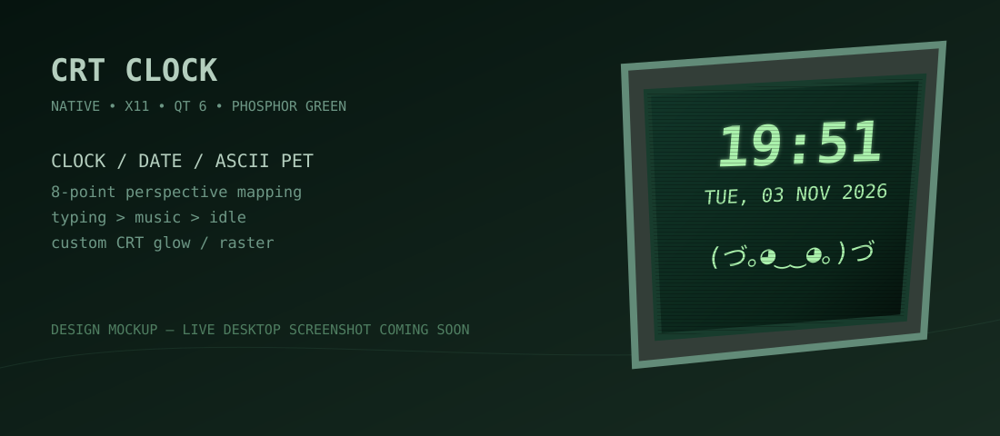
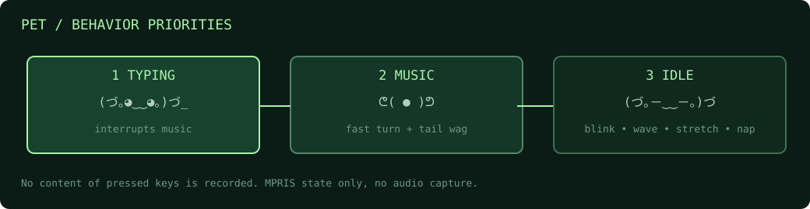

# CRT Clock



**Лёгкий виджет с перспективой для Arch Linux + XFCE/X11.** Часы, дата и символьный питомец размещаются непосредственно на наклонённом экране компьютера из обоев. Остальные окна не искажаются.

> Макет в заголовке — иллюстрация, а не скриншот программы. Финальный скриншот рабочего стола добавим отдельно, когда он будет готов.

## Установка

```bash
git clone https://github.com/Tifiat/crt-clock.git
cd crt-clock
makepkg -si
```

Сборка через официальный Arch `makepkg`, без Python, Electron, WebView или фонового браузера. Требуются Qt 6 и X11, зависимости устанавливаются пакетным менеджером.

**Обновление:**

```bash
cd ~/crt-clock
git pull --ff-only
makepkg -si
crt-clock --quit
crt-clock >/dev/null 2>&1 &
```

Файл пользовательских настроек сохраняется при переустановке.

## Управление

| Команда / клавиша | Действие |
|---|---|
| `crt-clock` | Запустить один экземпляр |
| `crt-clock --calibrate` | Режим калибровки с 8 крайними и 1 центральной точкой |
| `Super+Shift+C` | Та же калибровка глобальной клавишей в X11 |
| `crt-clock --settings` | Настройки CRT-графики (также по ПКМ на виджете) |
| `crt-clock --quit` | Завершить |
| **Enter / Esc** | Сохранить / отменить калибровку |
| **B / F** | В калибровке переключить фон / рамку |

Автозапуск **намеренно не включается при установке**. Когда результат устроит, добавь команду `crt-clock` в XFCE → **Settings → Session and Startup → Application Autostart**.

## Настройка перспективы


**Точки 1–4** соответствуют углам экрана, **5–8** — серединам сторон. Все восемь независимо деформируют экран. **Центральная точка 9** двигает весь виджет целиком. Используется сетка из четырёх проективно преобразованных участков. Старые значения четырёх углов из v0.2 автоматически сохраняются, новые середины сначала вычисляются из них.

В обычном режиме: прозрачное для кликов окно, без рамки, без кнопки в панели задач.

## CRT-графика

В `crt-clock --settings` доступны яркость, зелёный цвет, свечение, **реальные сканирующие линии и апертурную сетку в пикселях экрана**, а также редкую рябь сигнала без шейдеров, пикселизация символов, прозрачность фона, двойное редкое мерцание часов и отключаемая рамка.

Программа рисует внутреннее изображение 480×320, затем накладывает перспективу **только на него**. Не используется глобальный шейдер на весь экран. Реальная нагрузка зависит от композитора XFCE и требует проверки на ноутбуке.

## Питомец



Оригинальная базовая поза — `(づ｡◕‿‿◕｡)づ`. Все 26 поз питомца заранее заданы строками строго из 10 символов. Каждая позиция рисуется в собственной ячейке фиксированной сетки 10×40 пикселей с постоянным размером шрифта 38 px. При анимации не измеряется ширина Unicode-символов, не меняется размер шрифта и не пересчитывается компоновка. Допустимы лишь заранее предусмотренные смещения головы или тела на 2–3 px. Режим печати немного сдвигает питомца влево, освобождая справа место для японского символа.

Приоритеты строго определены: **печать → музыка → idle**.

| Режим | Поведение |
|---|---|
| **Typing** | При печати в любом окне короткие движения лапками и изменение одного японского символа при каждом обнаруженном нажатии. Символы нарисованы векторными штрихами, без необходимости устанавливать японские шрифты. Реакция прекращается после паузы около 1 секунды, содержимое клавиш не читается и не сохраняется |
| **Music** | При воспроизведении в MPRIS-плеере случайное чередование нескольких действий по 3–5 секунд: кивание головой, виляние хвостом, махание руками, покачивание и подскоки |
| **Idle** | Редкие небольшие сценарии: моргание, взгляд в стороны, махание, потягивание, дремота, удивление, покачивание |

Танец и виляние хвостом **не являются idle-анимацией**. Если при музыке начинается печать, танец сразу прерывается, а после прекращения печати возобновляется.

Реакцию на музыку и печать можно отключить раздельно. Музыкальная интеграция читает только статус `Playing` через MPRIS. Если AIMP не предоставляет MPRIS, останутся обычные idle-анимации.

## Конфигурация и код

Файл настроек: `~/.config/crt-clock/config.ini`.

```text
src/
  main.cpp               Qt-окно, часы, конфигурация, меню
  crt_style.hpp          Свечение, пиксельный растр, прозрачность
  perspective.hpp        8 маркеров, разбиение на 4 проекции
  pet_poses.hpp          Наборы поз с фиксированной геометрией
  pet_render.hpp         Отрисовка поз по слотам и встроенные векторные кандзи
  pet_animation.hpp      Отдельные сценарии и приоритеты
  keyboard_activity.*    Сигнал активности клавиатуры X11
```

В `[quad]` хранятся координаты `x0/y0 … x7/y7`; раздел `[appearance]` управляет цветами, яркостью и CRT. Обновление пакета не трогает пользовательскую геометрию.

**Ограничения:** предназначено для одного X11-экрана. ПКМ перехватывается виджетом, поэтому он больше не полностью прозрачен для мыши; запрос на все рабочие столы выполняется через EWMH/XFCE. Простая рябь имитирует помехи линиями, не искажая изображение пиксельным шейдером; обработка печати использует доступное X11-состояние клавиш, не глобальное перехватывание текста. Горячая клавиша может конфликтовать с другой программой. Параметры CRT и девять управляющих точек нужно проверять на реальном XFCE после каждого крупного изменения.

## Разработка

```bash
cmake -S . -B build -DCMAKE_BUILD_TYPE=Release
cmake --build build --parallel 2
```

GitHub Actions собирает проект на Ubuntu с Qt 6 и libX11. Здесь будут добавлены автоматические тесты и финальный скриншот рабочего стола.

## После обновления до 0.4.1

```bash
cd ~/crt-clock
git pull --ff-only
makepkg -si
crt-clock --quit
crt-clock >/dev/null 2>&1 &
```

ПКМ по монитору на обоях открывает меню. Настройки не должны завершать процесс виджета. Если XFCE не помечает окно как находящееся на всех рабочих столах, нужно проверить поддержку EWMH конкретной оконной конфигурацией.
