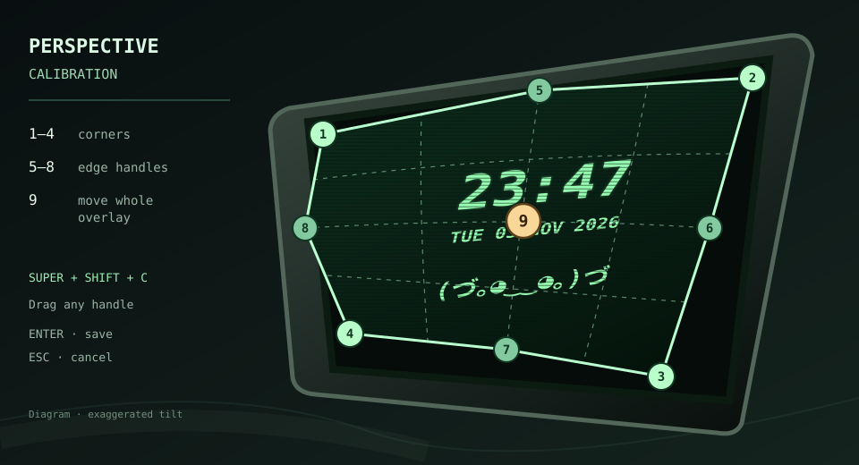

# CRT Clock

A lightweight **Qt 6 / X11 desktop widget** that perspective-maps a clock, date, and animated character onto a monitor in your wallpaper. Only the widget is warped, not the desktop or other windows.

Designed for **Arch Linux + XFCE (X11)**. No Electron, browser, or GPU shader required.

## Features

- **8-point perspective calibration:** four corners and four independent edge handles; a ninth center handle moves the entire overlay.
- **CRT effects:** phosphor glow, stationary scanlines, adjustable moving-scanline speed, pixel grid, colors, and brightness.
- **Animated pet:** idle expressions, continuous joyful-eye tail wag, MPRIS music dances, and typing reactions. Typing displays two rising columns of Japanese symbols; key contents are never recorded.
- **Desktop integration:** XFCE/X11 all-workspace hints and optional XDG autostart, with a right-click settings menu.

**Appearance:** set clock/date and pet fonts independently; adjust time, date, and pet size, pet stroke thickness, moving-scanline speed, and clock-flicker frequency (0 = off, 100 = about every 4 seconds). Font pickers list installed fonts and accept a typed family.

## Install (Arch Linux)

```bash
git clone https://github.com/Tifiat/crt-clock.git
cd crt-clock
makepkg -si
crt-clock
```

Requires Qt 6 and X11; `makepkg` installs package dependencies.

## Controls

| Command / shortcut | Action |
| --- | --- |
| `crt-clock` | Start the widget |
| `crt-clock --calibrate` or `Super+Shift+C` | Adjust the screen perspective |
| Drag handles 1–8 | Warp individual corners or edges |
| Drag handle 9 | Move the whole overlay |
| `Enter` / `Esc` (in calibration) | Save / cancel |
| `B` / `F` (in calibration) | Background / frame |
| `crt-clock --settings` or right-click | Appearance and animation settings |
| `crt-clock --quit` | Stop the widget |

### Perspective calibration



The diagram exaggerates the tilt to show what each control does. The actual overlay is fitted manually to the monitor in your wallpaper.

Settings are stored in `~/.config/crt-clock/config.ini` and survive updates.

To launch the widget at login, enable **Start CRT Clock automatically at login** in Settings. This creates `~/.config/autostart/crt-clock.desktop` for the current user; no system service is installed. Disable the checkbox to remove it. The workspace option sends EWMH sticky/all-desktops hints to the X11 window manager.

## Update

```bash
cd ~/crt-clock
git stash push -m "local PKGBUILD" -- PKGBUILD
git pull --ff-only
makepkg -Cfsi
crt-clock --quit
crt-clock >/dev/null 2>&1 &
```

The `stash` step protects the local `PKGBUILD` version change that `makepkg` may leave behind. Restart the widget after installation (also after adding new system fonts); calibration and configuration are retained.

## Build & test

```bash
cmake -S . -B build -DCMAKE_BUILD_TYPE=Release
cmake --build build --parallel 2
ctest --test-dir build --output-on-failure
```

## Development

Pet frames, animation sequences, and rendering are separate modules. See [animation architecture](docs/ANIMATION_ARCHITECTURE.md) and the [approved animation catalog](docs/ANIMATION_CATALOG.md) before extending the pet.

Real desktop screenshots will replace illustrative imagery when available. See the [capture checklist](docs/SCREENSHOT_PLAN.md).
